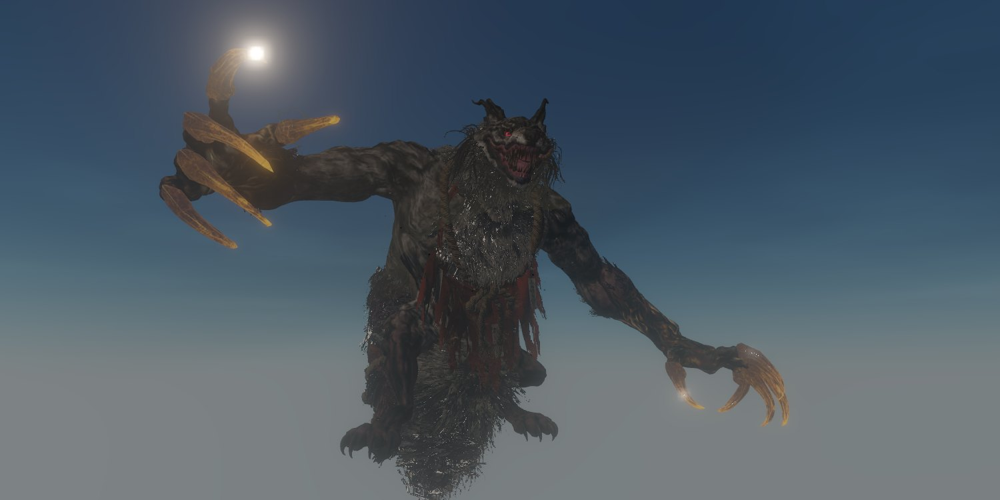

# G1 Viewer

The **G1 Viewer** is a file previewer and extractor for Koei Tecmo's games. 
It allows you to view almost all "G1" files include models, textures, animations, 
and effects right in your browser. Open single files, a folder, 
or a game's archive, and look at what is inside: models with their textures 
and motions, cloth and hair simulated live, effects played back, whole 
stages built from their placement data, sounds played. Supports games 
from all consoles from the PS3 era to today's PC games. Models export to 
glTF, FBX and OBJ, and textures to PNG and TGA.

Note: This is NOT a modding tool. All viewable asset must be supplied. Everything
runs in the page: what you open is read in your browser and never uploaded anywhere.

### ▶ Open the viewer: **[https://hearhellacopters.github.io/G1Viewer/](https://hearhellacopters.github.io/G1Viewer/)**

[Version 0.6.0](CHANGELOG.md) 

## Supported files

| Files | Extensions | What you see |
|---|---|---|
| **Models** | `.g1m` `.g1mx` `.g1mz` | skeletons, skinned meshes and materials, levels of detail; cloth, hair and other physics simulated live |
| **Textures** | `.g1t` `.g1tl` | every pixel format and platform layout; cube, volume and array textures |
| **Motions** | `.g1a` `.g2a` | model, camera and light motions, scrubbed, looped and blended |
| **Faces and shape keys** | `.g1h` `.g1fpose` `.g1frani` | shape keys, face poses and the animations that weight them |
| **Swinging parts** | `.swg` | accessories that swing with the body, simulated |
| **Effects** | `.g1fx` `.g1e` `.g1em` | particle and mesh effects, played back on the model |
| **Shaders** | `.g1s` `.g2s` | the games' own shader programs, run in the browser |
| **Stages** | `.kidsobjdb` and older games' stage files | whole stages built from their placement data, with their own sky and light where the files hold them |
| **Sound** | banks and streams | played, looped and saved as `.ogg` or `.wav` |
| **Archives** | `LINKDATA`, `.rdb`, `.lnk` and more | a game's archive browsed without extracting it |

The full breakdown - every extension, sound codec, and which games' archives
open - is in **[FORMATS.md](FORMATS.md)**.

See full list of [all features here](FEATURES.md).

[Report a problem or send samples](https://github.com/hearhellacopters/G1Viewer/issues/new/choose).

## Using it

Open the link above in a current Chrome, Edge or Firefox. Then drop files onto
the page, or use **Open files…** / **Open folder…** under *Loaded* to view
files, or under *Archives* to browse a game archive without extracting it.
Click **G1 Viewer** at the top left for the full list of what it opens, and
the version number beside it for the changelog.

To run it yourself, serve this repository's files with any static web host -
it needs no server code and no configuration, and works at a domain's root or
in a subfolder. GitHub Pages serves it as it is.

## Why this repository is a build, not a source

This is a **published build** of the viewer: the page, minified, and nothing
else. The source is kept private, on purpose:

- **It is a viewer, not a mod tool.** It is made for looking at and learning
  from the games' files. It reads them; it does not repack, patch or write game
  data back.
- **The source holds reverse engineered knowledge of a proprietary engine.**
  How these formats work, and how the games' own systems behave, was worked out
  by reverse engineering. That research is not shared, out of respect for the
  developers whose work it describes.
- **No games of cat and mouse.** Keeping the source private helps 
  development and long term support: fixes for new builds can happen without 
  the fear of the game engine designers changing things just to throw us off 
  if they don't what we already know.

## Report a problem, send samples, ask for a feature

Use **[New issue](https://github.com/hearhellacopters/G1Viewer/issues/new/choose)** and pick a form:

- **Bug report** - something does not open, looks wrong, or breaks.
- **Sample files** - a game, format or file the viewer does not handle yet, or
  handles wrongly.
- **Feature request** - something you would like the viewer to do.

What helps most:

- The **game, its platform and region**, and which files you opened;
- A **screenshot**, and for anything that looks wrong, what it should look like
  (a screenshot from the game is ideal);
- For samples: **only the G1 files are needed** - attach them zipped (GitHub takes
  attachments up to 25 MB), or link to a download for larger sets. Please share
  only files from a copy of the game you own.

Search the [existing issues](https://github.com/hearhellacopters/G1Viewer/issues) first: someone may have sent
the same game already.

## Notes

- Not affiliated with or endorsed by Koei Tecmo. Game names and trademarks
  belong to their owners. No game files are included here.
- The libraries the viewer includes, and their licences:
  [THIRD_PARTY_LICENSES.txt](THIRD_PARTY_LICENSES.txt).

<!-- This README is written by the G1 Viewer's publish step from its template on every release; edit the template, not this file. -->
